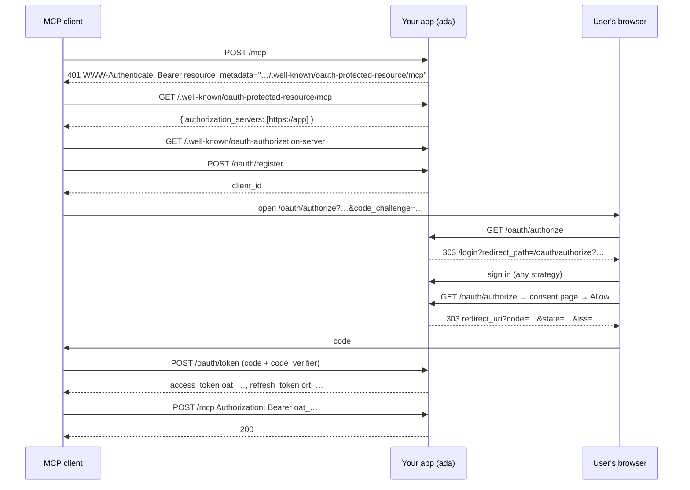

# Authorization Server

`oauthserver` makes your application its own OAuth 2.1 authorization server. An MCP client, a CLI or an editor extension can then connect to your application on its own: it registers, sends the user to your login page, and gets a token for the user. You don't need Keycloak or any other identity provider.

::: tip
Most applications should start from the [Auth Kit](./kit), which shows how to combine this server with local users, roles and the login page. This page is the reference for the server on its own.
:::

The [resource server](./resource-server) page covers the other case, where tokens come from an external identity provider. Use this page when the application issues the tokens itself.

## What you get

| Endpoint | Standard | Path |
|---|---|---|
| Authorization server metadata | RFC 8414 | `/.well-known/oauth-authorization-server{base}` and `{base}/.well-known/oauth-authorization-server` |
| OpenID-style discovery | OIDC Discovery | `/.well-known/openid-configuration{base}` and `{base}/.well-known/openid-configuration` |
| Protected resource metadata | RFC 9728 | `/.well-known/oauth-protected-resource{resource path}` (from `auth.Config.ProtectedResource`) |
| Dynamic client registration | RFC 7591 | `POST {base}oauth/register` |
| Authorization + consent | RFC 6749, PKCE RFC 7636 | `GET/POST {base}oauth/authorize` |
| Consent info for a custom page | — | `GET {base}oauth/authorize/info` |
| Token (code, refresh) | RFC 6749 | `POST {base}oauth/token` |
| Revocation | RFC 7009 | `POST {base}oauth/revoke` |
| Empty key set | — | `GET {base}oauth/jwks` |

The server also has the following properties:

- PKCE S256 is mandatory.
- Refresh tokens rotate. Two refreshes that race on the same token produce exactly one new token.
- The authorization response carries `iss` (RFC 9207).
- Clients can ask for a resource indicator (RFC 8707).
- Loopback redirect URIs match on any port (RFC 8252).
- Consent can be remembered.
- A client that registers again is reused instead of creating a duplicate.
- Discovery and token endpoints send CORS headers, so browser clients such as MCP Inspector work.

Tokens are opaque random strings with a prefix (`oat_…`, `ort_…`). Only their SHA-256 hashes are stored.



## Minimal wiring

```go
import (
    "github.com/rakunlabs/ada/middleware/auth"
    "github.com/rakunlabs/ada/middleware/auth/authz"
    "github.com/rakunlabs/ada/middleware/auth/oauthserver"
    "github.com/rakunlabs/ada/middleware/auth/resource"
    "github.com/rakunlabs/ada/middleware/auth/session"
    "github.com/rakunlabs/ada/middleware/auth/strategy/local"
)

oauth, err := oauthserver.New(oauthserver.Config{
    Issuer:          "https://app.example.com", // pin it in production
    ServiceName:     "My App",
    ScopesSupported: []string{"mcp"},
    DefaultScopes:   []string{"mcp"},
}, oauthserver.NewMemoryStore())
if err != nil {
    return err
}

authMW := auth.New(auth.Config{
    // No AuthorizationServers: WithOAuthServer points the metadata at oauth.
    ProtectedResource: &resource.Config{
        Resource:        "https://app.example.com/mcp",
        ScopesSupported: []string{"mcp"},
        ResourceName:    "My App",
    },
})
authMW.Strategy(local.New("local", verifyUser))
authMW.WithOAuthServer(oauth)

if err := authMW.Init(ctx); err != nil {
    return err
}

server, err := ada.NewWithFunc(ctx, func(ctx context.Context, mux *ada.Mux) error {
    // Login routes, RFC 9728 metadata and every OAuth endpoint.
    authMW.Mount(mux)

    mcp := mux.Group("/mcp")
    mcp.Use(session.DisableRedirect(), authMW.Require(), authz.RequireScope("mcp"))
    mcp.HandleWildcard("/", mcpHandler)

    return nil
})
```

`WithOAuthServer` does the wiring for you:

1. **Sign-in.** The authorize endpoint is guarded by the session middleware. A user who is not signed in goes to the normal login UI, using whatever strategies you registered (local, OIDC, passkey, LDAP…), and comes back to the consent page.
2. **Token checks.** `authMW.Require()` accepts the server's access tokens. The token's scopes replace the user's session scopes, so `authz.RequireScope` sees what the user approved.
3. **Discovery.** If `ProtectedResource` has no `AuthorizationServers`, it advertises this server.
4. **Routes.** `Mount` registers the OAuth endpoints and well-known documents at the origin.

## Hooks: permissions

Without hooks, any signed-in user can approve any client for any supported scope. Hooks are how your own permission model joins the flow:

```go
oauthserver.Config{
    Hooks: oauthserver.Hooks{
        // Runs before the consent page, with the user known.
        Authorize: func(ctx context.Context, req *oauthserver.AuthorizeRequest) error {
            // Narrow scopes the user may not have.
            if !req.Identity.HasRole("admin") {
                req.Scopes = slices.DeleteFunc(req.Scopes, func(s string) bool { return s == "mcp:admin" })
            }

            // Limit the token to one sub-resource: https://app/mcp/<conn>.
            if conn := strings.TrimPrefix(resourcePath(req.Resource), "/mcp/"); conn != "" {
                if !canUse(ctx, req.Identity.Subject, conn) {
                    return &oauthserver.Error{Code: "invalid_target", Description: "no access to " + conn}
                }
                req.Extra = map[string]any{"connection": conn}
            }

            return nil
        },

        // Runs at code exchange, refresh and on every request. A disabled
        // user loses access immediately, not when the token expires.
        Identity: func(ctx context.Context, t *oauthserver.Token) (*identity.Identity, error) {
            u, err := myUsers.Get(ctx, t.Subject())
            if errors.Is(err, store.ErrNotFound) || (err == nil && u.Disabled) {
                return nil, oauthserver.ErrAccessDenied
            }
            if err != nil {
                return nil, err
            }

            return u.Identity(), nil // fresh roles
        },

        // Optional per-token lifetimes.
        TokenTTL: func(ctx context.Context, t *oauthserver.Token) (access, refresh time.Duration) {
            return time.Hour, 7 * 24 * time.Hour
        },
    },
}
```

| Hook | When it runs | What it can do |
|---|---|---|
| `Authorize` | After the request is valid and the user is known, before consent | Narrow `req.Scopes`. Attach `req.Extra`, which is copied onto the token. Refuse with `*oauthserver.Error`, which is sent to the client's redirect URI. A hook that tries to widen scopes is rejected. |
| `Identity` | At code exchange, at refresh, and on every validated request | Return a fresh identity, or `ErrAccessDenied` to refuse. Any other error is treated as an outage (500). |
| `TokenTTL` | When a token is issued | Override the access and refresh lifetimes. A negative refresh TTL means no refresh token is issued. |

### Reading the token in handlers

```go
func mcpHandler(w http.ResponseWriter, r *http.Request) {
    id := identity.FromContext(r.Context()) // the user, with the token's scopes

    if info := oauthserver.Info(id); info != nil {
        // Authenticated with an OAuth or personal token.
        conn, _ := info.Extra["connection"].(string)
        _ = info.ClientID
        _ = info.Resource
    }
}
```

`Info` returns `nil` when the request was authenticated another way, such as a session cookie or an API key.

### Sub-resources: `/mcp/{conn}`

A token can be limited to one sub-endpoint. Set `Subresources` so that a request to `/mcp/shop` gets a challenge for `https://app/mcp/shop` and that metadata document is served:

```go
ProtectedResource: &resource.Config{
    Resource:     "https://app.example.com/mcp",
    Subresources: true,
}
```

The client then sends `resource=https://app.example.com/mcp/shop`. Your `Authorize` hook checks it, and the handler compares `info.Resource` or `info.Extra` with the path it serves.

## Storage

| Store | Use |
|---|---|
| `oauthserver.NewMemoryStore()` | Tests, single-process tools. MCP clients register again after a restart. |
| Your own | Implement `oauthserver.Store` on your database. Add `ClientFinder` for client reuse and `ConsentStore` for remembered consent. |

A complete SQL store for PostgreSQL, SQLite and MySQL (schema included) is in the Auth Kit example, [`_examples/authkit/store`](https://github.com/rakunlabs/ada/tree/main/_examples/authkit/store). Copy it into your app, or use it as the reference for your own data layer. Put its schema into your migrations (muz).

Remove expired rows periodically (the example store has `DeleteExpired`):

```go
job, _ := hardloop.NewCron(hardloop.Cron{
    Name:  "oauth-cleanup",
    Specs: []string{"*/15 * * * *"},
    Func:  func(ctx context.Context) error { return st.DeleteExpired(ctx, time.Now()) },
})
job.Start(ctx)
```

### Writing your own Store

```go
type Store interface {
    CreateClient(ctx, *Client) error
    GetClient(ctx, id) (*Client, error)               // ErrNotFound when unknown
    SaveCode(ctx, *Code) error
    TakeCode(ctx, hash) (*Code, error)                // read and delete in one step
    SaveToken(ctx, *Token) error
    TokenByAccess(ctx, accessHash) (*Token, error)
    TokenByRefresh(ctx, refreshHash) (*Token, error)
    RotateToken(ctx, oldRefreshHash, *Token) error    // compare-and-swap; ErrConflict on a race
    DeleteToken(ctx, id) error
}
```

Rules. Breaking one of them does not fail loudly: the app keeps working and the hole stays open, so test each one (the example store's tests do).

- Return `oauthserver.ErrNotFound` for missing records. Any other error is treated as an outage.
- `TakeCode` must be single-use across replicas: read and delete in one transaction, and let the `DELETE`'s affected row count decide: 0 rows means another request took it, so return `ErrNotFound`. A `SELECT` followed by an unchecked `DELETE` lets two concurrent exchanges both win.
- `RotateToken` must be a conditional update: `UPDATE … WHERE id = ? AND refresh_hash = ?`. If no row changed, return `ErrConflict`.
- `TokenByRefresh` must also find a token by its `PreviousRefreshHash`. That is how a replayed refresh token is detected.
- Persist every `Token` field: `GrantedScopes`, `PreviousRefreshHash`, `RotatedAt` included.
- Store `Identity` and `Extra` as JSON. After decoding, `[]string` claims come back as `[]any`; convert the ones your code type-asserts.
- On SQLite, serialize writes (a mutex) or concurrent refreshes fail with `SQLITE_BUSY`.

## Personal access tokens

The same server issues long-lived tokens for a "tokens" settings page. They work with `authMW.Require()` exactly like OAuth tokens.

```go
user := mux.Group("/api/v1", authMW.Require())

user.POST("/tokens", func(c *ada.Context) error {
    var in struct {
        Name string `json:"name"`
        Days int    `json:"days"`
    }
    if err := c.Bind(&in); err != nil {
        return ada.WrapHTTPError(http.StatusBadRequest, err)
    }

    raw, tok, err := oauth.IssueToken(c.Request.Context(), oauthserver.IssueRequest{
        Name:     in.Name,
        Identity: identity.FromContext(c.Request.Context()),
        Scopes:   []string{"mcp"},
        TTL:      time.Duration(in.Days) * 24 * time.Hour, // 0 = never expires
    })
    if err != nil {
        return err
    }

    // raw is shown once; tok.ID is how the user lists and revokes it.
    return c.SetStatus(http.StatusCreated).SendJSON(map[string]any{"id": tok.ID, "token": raw})
})

user.DELETE("/tokens/{id}", func(c *ada.Context) error {
    // Check ownership with your store (e.g. a TokensBySubject query) first.
    return oauth.RevokeToken(c.Request.Context(), c.Request.PathValue("id"))
})
```

## Custom consent page

The built-in page is server-rendered HTML with a CSRF cookie and `X-Frame-Options: DENY`. To use your SPA instead:

```go
oauthserver.Config{ConsentURL: "/#/oauth/authorize"}
```

The browser is sent to `ConsentURL?<original query>`. Your page then does two things:

1. Calls `GET {base}oauth/authorize/info?<query>` with the session cookie.
   - If the response has `redirect`, navigate there. This happens on a remembered approval or on an error the client must receive.
   - Otherwise it gets `{client, scopes, resource, extra, service_name, name, email}` to render.
2. Answers with `POST {base}oauth/authorize`, `Content-Type: application/json`, body `{...query params, "approve": true, "remember": true}`. The response is `{"redirect": "…"}`; navigate there.

A JSON body cannot be sent cross-origin without a CORS preflight, and these endpoints never answer one. That is the CSRF protection for this path.

## Applications without `middleware/auth`

Pass any middleware that puts the user in the context, and protect routes with `RequireToken`:

```go
oauth, _ := oauthserver.New(oauthserver.Config{
    Issuer: "https://app.example.com",
    // Must call identity.WithContext, or redirect to sign in.
    Authenticate: mySessionMiddleware,
}, store)

oauth.Mount(mux)

rs, _ := resource.New(resource.Config{
    Resource:                 "https://app.example.com/mcp",
    AuthorizationServersFunc: oauth.AuthorizationServers,
})
for _, p := range rs.Paths() {
    mux.HandleWithMethod(http.MethodGet, p, rs.Handler())
}

mux.Handle("/mcp", oauth.RequireToken(rs)(mcpHandler))
```

## Behind a proxy

The issuer is the base URL every endpoint is advertised under. It is chosen in this order:

1. `IssuerFunc(r)`, for example an external URL an administrator can change at runtime.
2. `Issuer`, a pinned URL. **Use this in production.**
3. The request origin plus `BasePath`. Forwarding headers count only from `TrustedProxies`, or from any peer with `UnsafeTrustAllForwardedHeaders`.

If a proxy strips a prefix (`https://host/app/…` reaches the process as `/…`), pin `Issuer: "https://host/app"` and keep `BasePath: "/"`. The advertised URLs then carry the prefix while the mux paths stay unprefixed.

## Config

| Field | Default | Description |
|---|---|---|
| `Issuer` | derived | Public base URL. Endpoints are `{Issuer}/oauth/…` |
| `BasePath` | `/` | Mux prefix of the endpoints. Use the same value as `auth.Config.Base` |
| `ServiceName` | issuer host | Shown on the consent page |
| `ScopesSupported` | any | Accepted scopes. Other scopes get `invalid_scope` |
| `DefaultScopes` | none | Granted when the client asks for none |
| `CodeTTL` | `5m` | Authorization code lifetime |
| `AccessTTL` | `1h` | Access token lifetime |
| `RefreshTTL` | `720h` | Absolute refresh lifetime from the first sign-in. Rotation does not extend it. Negative disables refresh tokens |
| `AccessTokenPrefix` / `RefreshTokenPrefix` | `oat_` / `ort_` | Lets the strategy recognize its own tokens next to API keys and JWTs |
| `Resources` | issuer origin | Resource identifiers clients may request. A path below one is accepted (`…/mcp/shop`) |
| `RegistrationsPerHour` | `60` | Dynamic registrations per client IP. Negative disables the limit |
| `DisableRegistration` | `false` | Turn off RFC 7591. Create clients with `Server.RegisterClient` |
| `RootFallback` | `false` | Also answer `/authorize`, `/token`, `/register` at the root, for MCP 2025-03-26 clients |
| `DisableOpenIDConfiguration` | `false` | Don't publish the OIDC-style document |
| `ConsentURL` | built-in | Your own consent page |
| `CSRFCookie` | strict, HttpOnly | Cookie options for the built-in consent form |
| `TrustedProxies` | none | CIDRs whose forwarding headers count when the issuer is derived |
| `StrategyName` | `oauth` | `Identity.Provider` of token-authenticated requests |
| `IssuerFunc` | — | Per-request issuer |
| `Authenticate` | `Auth.Require` | Session middleware guarding the authorize endpoints |
| `Hooks` | — | See [Hooks](#hooks-permissions) |

## Security notes

- **The redirect URI is checked before anything is sent to it.** An unknown client or an unregistered redirect is shown to the user and never redirected to.
- **A code is single-use.** It is consumed before the verifier is checked, so a wrong `code_verifier` burns the code.
- **Token scopes replace session scopes; roles are kept.** A token approved for `mcp:read` fails `authz.RequireScope("mcp:write")` even if the user's session has it. `Identity.Roles` still holds the user's roles (fresh ones when `Hooks.Identity` is set). Gate what a token may do by scope, and gate who the user is by role.
- **A token only works on the resource it was issued for.** A token granted for `https://app/mcp/shop` is refused on `/mcp/admin`, on `/mcp` and on every other route (RFC 8707 audience). Clients may only name resources in `Resources`, or on the issuer's origin when that list is empty. A resource can't be added at the token step.
- **Refresh-token replay revokes the grant.** Within 30 seconds of a rotation, a second use of the old refresh token is treated as a client retrying a raced request: it is refused and nothing else happens. After that, using the old token again revokes the whole grant, including the token the legitimate client holds now (OAuth 2.1 §4.3.1).
- **Narrowing scopes on refresh is per access token.** A refresh with `scope=mcp:read` narrows that one access token. The next refresh can ask for everything the user approved again.
- **Registration is rate-limited.** Each client IP gets `RegistrationsPerHour` registrations (default 60). Re-registering a known client doesn't count.
- **Consent pages are CSRF-protected.**
  - The built-in page uses one cookie per authorization request, so two open consent tabs both work.
  - A custom page's JSON POST must be same-origin (`Sec-Fetch-Site` or `Origin`).
  - Remembered consent covers the scopes, the resource and the hook's `Extra`. If any of them changes, the user is asked again.
- **Revocation is not an oracle.** A client revoking another client's token gets the same `200` as for an unknown token, and nothing is revoked.
- **Confidential clients** (`client_secret_basic`, `client_secret_post`) are supported through `RegisterClient` or a registration request. Secrets are stored hashed and compared in constant time.
- **No ID tokens or JWTs.** The JWKS is empty on purpose. A resource server in another process validates these tokens by sharing the store, not by verifying signatures.
