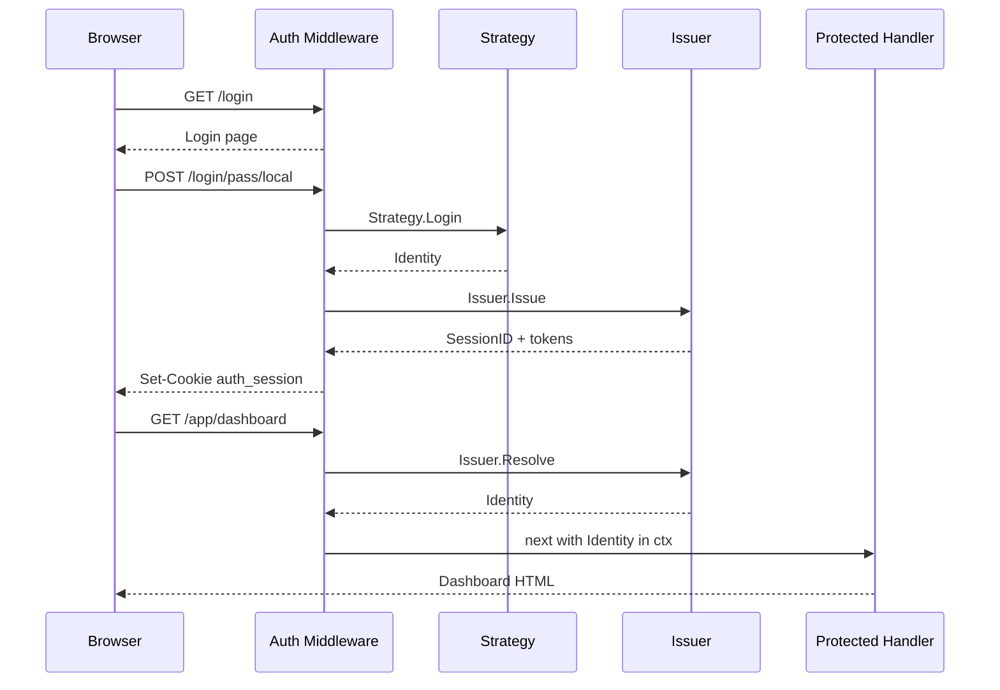
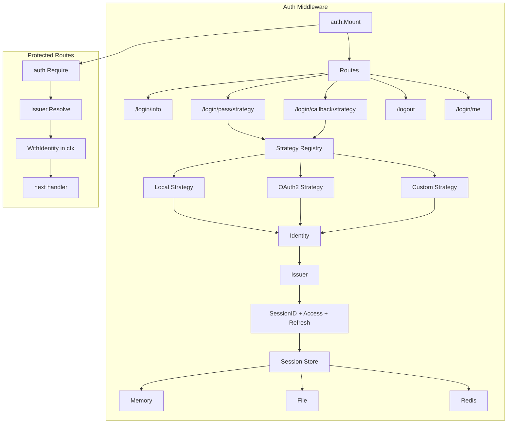

# Auth

Auth middleware provides a pluggable authentication system with session management, a built-in login UI, and support for multiple authentication strategies (local credentials, OAuth2/OIDC, custom).

## Import

```go
"github.com/rakunlabs/ada/middleware/auth"
"github.com/rakunlabs/ada/middleware/auth/strategy/local"
authoauth2 "github.com/rakunlabs/ada/middleware/auth/strategy/oauth2"
```

## How It Works

Authentication is a **one-shot event**. A strategy (OAuth2, local, etc.) verifies the user's identity once and returns a normalized `Identity`. The middleware then mints its own opaque session token — the upstream IdP token is discarded immediately (optionally revoked). Every subsequent request resolves the session cookie through the internal issuer, never touching the IdP again.



## Quick Start

```go
import (
    "github.com/rakunlabs/ada/middleware/auth"
    "github.com/rakunlabs/ada/middleware/auth/identity"
    "github.com/rakunlabs/ada/middleware/auth/strategy/local"
)

authMW := auth.New(auth.Config{
    UI: auth.UIConfig{
        Title:    "My App",
        Subtitle: "Sign in to continue",
    },
})

authMW.Strategy(local.New("local",
    func(ctx context.Context, user, pass string) (*identity.Identity, error) {
        // Your credential check (database, LDAP, etc.)
        if user == "admin" && pass == "secret" {
            return &identity.Identity{
                Subject: "admin",
                Email:   "admin@example.com",
                Roles:   []string{"admin"},
            }, nil
        }
        return nil, local.ErrInvalidCredentials
    },
    local.WithLabel("Email & password"),
))

if err := authMW.Init(ctx); err != nil {
    return err
}

// Mount public auth routes
authMW.Mount(mux)

// Protect routes
app := mux.Group("/app")
app.Use(authMW.Require())
app.GET("/dashboard", func(w http.ResponseWriter, r *http.Request) {
    id := identity.FromContext(r.Context())
    fmt.Fprintf(w, "Hello, %s", id.Name)
})
```

## In This Section

| Page | What it covers |
|---|---|
| [Strategies](./strategies) | Local, OAuth2/OIDC, API key, bearer, LDAP, magic link, basic, header, mTLS, passkey |
| [Resource Server](./resource-server) | Accepting OAuth access tokens from MCP and CLI clients |
| [Configuration](./configuration) | `auth.Config`, OAuth2 config, ID token verification, mounted routes |
| [Identity & Access](./access) | Identity, authorization rules, MFA, lockout, password hashing |
| [Sessions](./sessions) | Issuer, token lifetimes, persistent session stores |
| [Login UI](./login-ui) | Built-in UI, theme tokens, custom stylesheet, custom login page |

## Architecture



## Complete Example

```go
package main

import (
    "context"
    "fmt"
    "net/http"
    "os"

    "github.com/rakunlabs/ada"
    "github.com/rakunlabs/ada/middleware/auth"
    "github.com/rakunlabs/ada/middleware/auth/identity"
    "github.com/rakunlabs/ada/middleware/auth/strategy/local"
    authoauth2 "github.com/rakunlabs/ada/middleware/auth/strategy/oauth2"
)

func main() {
    ctx := context.Background()

    authMW := auth.New(auth.Config{
        UI: auth.UIConfig{
            Title:    "My Application",
            Subtitle: "Sign in to your account",
            Version:  "v1.0.0",
        },
    })

    // Local strategy
    authMW.Strategy(local.New("local", verifyUser,
        local.WithLabel("Email & password"),
    ))

    // OAuth2 with OIDC Discovery + PKCE (auto-enabled)
    if clientID := os.Getenv("GOOGLE_CLIENT_ID"); clientID != "" {
        authMW.Strategy(authoauth2.New("google", authoauth2.Config{
            IssuerURL:    "https://accounts.google.com",
            ClientID:     clientID,
            ClientSecret: os.Getenv("GOOGLE_CLIENT_SECRET"),
            Scopes:       []string{"openid", "email", "profile"},
        }, authoauth2.Options{
            Label:            "Sign in with Google",
            CallbackBasePath: "/login/callback",
        }))
    }

    if err := authMW.Init(ctx); err != nil {
        panic(err)
    }

    server, _ := ada.NewWithFunc(ctx, func(ctx context.Context, mux *ada.Mux) error {
        authMW.Mount(mux)

        mux.GET("/", func(w http.ResponseWriter, r *http.Request) {
            fmt.Fprintln(w, "Public homepage")
        })

        app := mux.Group("/app")
        app.Use(authMW.Require())
        app.GET("/dashboard", func(w http.ResponseWriter, r *http.Request) {
            id := identity.FromContext(r.Context())
            fmt.Fprintf(w, "Hello %s (%s)", id.Name, id.Provider)
        })

        return nil
    })

    server.Start(":8080")
}

func verifyUser(ctx context.Context, user, pass string) (*identity.Identity, error) {
    // Replace with your database lookup
    if user == "admin" && pass == "secret" {
        return &identity.Identity{
            Subject: "admin",
            Name:    "Admin User",
            Email:   "admin@example.com",
            Roles:   []string{"admin"},
        }, nil
    }
    return nil, local.ErrInvalidCredentials
}
```

::: warning
The cookie defaults are the safe ones — `HttpOnly` on, `Secure` set whenever
the request is HTTPS. Pin `Cookie.Secure: "always"` if TLS terminates upstream
and the proxy forwards no `X-Forwarded-Proto`.

Two things still need a decision from you: a `Limiter` on any strategy that
takes a password or sends mail, and a `SessionKey` plus `WithCipher` on any
store that persists outside the process.
:::

::: danger
Never store secrets (`ClientSecret`, `SessionKey`, encryption keys) in source
code. Use environment variables or a secret manager.
:::
