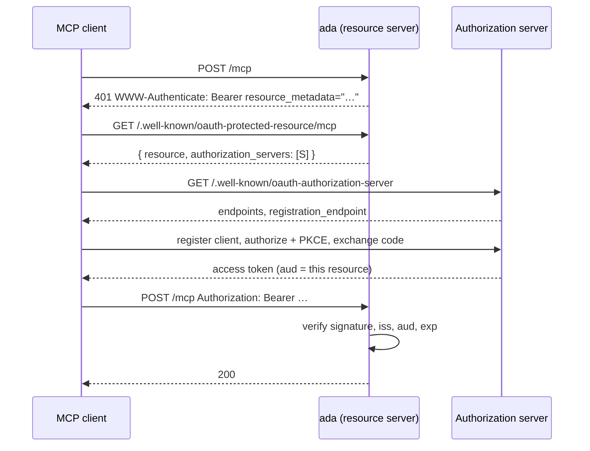

# Resource Server (MCP and CLI clients)

The [strategies](./strategies) assume a browser: a person clicks a button and ends up with a session cookie. A program cannot do that. An MCP client, an editor extension, a CLI running `auth login` — they have no cookie jar and no way to complete an interactive page.

The OAuth answer is discovery. The client calls a protected endpoint, gets a 401 that tells it where to ask, runs an OAuth flow on its own, and comes back with an access token:



ada plays the **resource server** role. The authorization server stays external — Keycloak, turna, Auth0 — and owns client registration, consent and token issuance.

## Wiring

Three pieces: metadata to publish, a strategy to enforce, and a marker so programmatic callers are challenged instead of redirected.

```go
import (
    "github.com/rakunlabs/ada/middleware/auth"
    "github.com/rakunlabs/ada/middleware/auth/resource"
    "github.com/rakunlabs/ada/middleware/auth/session"
    "github.com/rakunlabs/ada/middleware/auth/strategy/bearer"
)

const mcpResource = "https://api.example.com/mcp"

bearerStrategy, err := bearer.New(bearer.Config{
    Issuer:   "https://kc.example.com/realms/main",
    Audience: []string{mcpResource},
})
if err != nil {
    return err
}

authMW := auth.New(auth.Config{
    ProtectedResource: &resource.Config{
        Resource:             mcpResource,
        AuthorizationServers: []string{"https://kc.example.com/realms/main"},
        ScopesSupported:      []string{"mcp:read", "mcp:write"},
        ResourceName:         "Example MCP",
    },
})
authMW.Strategy(bearerStrategy)

if err := authMW.Init(ctx); err != nil {
    return err
}

server, err := ada.NewWithFunc(ctx, func(ctx context.Context, mux *ada.Mux) error {
    // Publishes GET /.well-known/oauth-protected-resource[/…] and hands the
    // metadata server to the bearer strategy.
    authMW.Mount(mux)

    mcp := mux.Group("/mcp")
    mcp.Use(session.DisableRedirect(), authMW.Require())
    mcp.POST("/", mcpHandler)

    return nil
})
```

`Mount` also pushes the metadata server into every strategy implementing `strategy.ResourceBinder`, so the bearer strategy learns the `resource_metadata` URL without being handed it twice. Use `WithProtectedResource` instead of the config field when you need the same `*resource.Server` instance somewhere built before `Init`.

## `session.DisableRedirect()`

Without it an unauthenticated request gets `303 See Other` to the login page. A browser wants that; a program follows the redirect, receives `200` and an HTML page it cannot parse, and reports a failure far from its cause.

`session.DisableRedirect()` marks everything under it as non-interactive, so the same request gets:

```http
HTTP/1.1 401 Unauthorized
WWW-Authenticate: Bearer resource_metadata="https://api.example.com/.well-known/oauth-protected-resource/mcp"
```

Apply it per route group. Browser routes keep the redirect.

## Path insertion

RFC 9728 §3.1 puts the resource's path **after** the well-known path, not before it:

| Resource identifier | Metadata URL |
|---|---|
| `https://api.example.com` | `https://api.example.com/.well-known/oauth-protected-resource` |
| `https://api.example.com/mcp` | `https://api.example.com/.well-known/oauth-protected-resource/mcp` |
| `https://api.example.com/v1/mcp` | `https://api.example.com/.well-known/oauth-protected-resource/v1/mcp` |

A request for any other suffix returns 404. Answering every path with the same document would assert this server guards resources it has never heard of.

## Scope enforcement

The bearer strategy authenticates; it does not authorize. A token that is authentic but lacks a scope is a 403, not a 401, and [`authz`](./access#authorization) already draws that line:

```go
mcp.Use(
    session.DisableRedirect(),
    authMW.Require(),
    authz.RequireScope("mcp:read"),
)
```

## Resource Config

| Field | Type | Default | Description |
|---|---|---|---|
| `Resource` | `string` | derived | Resource identifier, e.g. `https://api.example.com/mcp`. **Pin it in production** |
| `ResourcePath` | `string` | `""` | Path of a derived identifier, e.g. `/mcp`. Ignored when `Resource` is set |
| `AuthorizationServers` | `[]string` | — | Issuer identifiers whose tokens are accepted. Required unless `JWKSURI` is set |
| `JWKSURI` | `string` | `""` | The resource's own key set, for deployments with no authorization server in the loop |
| `ScopesSupported` | `[]string` | `nil` | Scopes a client may usefully request |
| `ResourceName` | `string` | `""` | Human-readable name shown during consent |
| `ResourceDocumentation` | `string` | `""` | Developer-facing URL |
| `CacheMaxAge` | `int` | `300` | `Cache-Control: max-age`. Negative disables caching |
| `TrustedProxies` | `[]string` | `nil` | CIDRs allowed to set `X-Forwarded-Proto`/`X-Forwarded-Host` when deriving the origin |

::: warning
Leaving `Resource` empty derives the identifier from the `Host` header. That means the value a client is told to request a token for follows the network in front of the process. Convenient in development, a liability in production — set it explicitly, or list `TrustedProxies` so forwarding headers only count from your own proxy.
:::

## Bearer Config

| Field | Type | Default | Description |
|---|---|---|---|
| `Issuer` | `string` | required | Expected `iss`, compared exactly. Also the discovery base |
| `JWKSURL` | `string` | discovered | Issuer key set. Skips discovery when set |
| `Audience` | `[]string` | required | Resource identifiers this server answers to |
| `DisableAudienceCheck` | `bool` | `false` | Accept any `aud`. See the [bearer strategy warning](./strategies#bearer-token-strategy) |
| `RequireAccessTokenType` | `bool` | `false` | Require JOSE header `typ: at+jwt` (RFC 9068). Turn it on when the issuer sets it |
| `ClockSkew` | `time.Duration` | `60s` | Leeway on `exp`/`nbf`. Negative disables it |
| `Claims.Subject` | `string` | `sub` | Claim path for the subject |
| `Claims.Name` | `[]string` | `name`, `preferred_username` | Claim paths tried in order |
| `Claims.Email` | `string` | `email` | Claim path for the email |
| `Claims.Roles` | `[]string` | `roles`, `realm_access.roles` | Claim paths merged into `Identity.Roles` |

Every `Claims` entry accepts a dotted path, so a Keycloak client role set is configuration rather than a code change:

```go
bearer.Config{
    Claims: bearer.ClaimMap{
        Roles: []string{"resource_access.mcp.roles"},
    },
}
```

## Discovery

When `JWKSURL` is empty the issuer's metadata is fetched lazily on the first token, trying each layout the ecosystem left behind:

1. `{origin}/.well-known/oauth-authorization-server{path}` — RFC 8414 path insertion
2. `{origin}/.well-known/openid-configuration{path}` — RFC 8414 layout, OIDC document
3. `{origin}{path}/.well-known/openid-configuration` — OpenID Connect Discovery 1.0

The `issuer` in the document must equal the configured `Issuer` (RFC 8414 §3.3). Without that check, anyone who can influence the discovery URL can point the verifier at a JWKS they control and every token they mint verifies.

## Opaque tokens

Local JWT verification is the default. For opaque tokens, supply a `Verifier` — an RFC 7662 introspection call, typically. The strategy still applies the `iss`, `aud` and `exp` checks to whatever comes back, so a custom verifier cannot widen who is let in:

```go
bearer.New(cfg, bearer.Options{
    Verifier: bearer.VerifierFunc(func(ctx context.Context, token string) (map[string]any, error) {
        return introspect(ctx, token)
    }),
})
```

## What ada does not do

ada is a resource server, not an authorization server. It does **not** implement:

- `/.well-known/oauth-authorization-server` (RFC 8414) as a publisher
- Dynamic Client Registration (RFC 7591) — the `POST /register` endpoint an MCP client uses to enroll itself
- `/authorize`, `/token`, consent UI, or token introspection as a server

Those belong to the authorization server you point `AuthorizationServers` at. [turna](https://github.com/rakunlabs/turna) implements all of them if you need one in the same stack.
