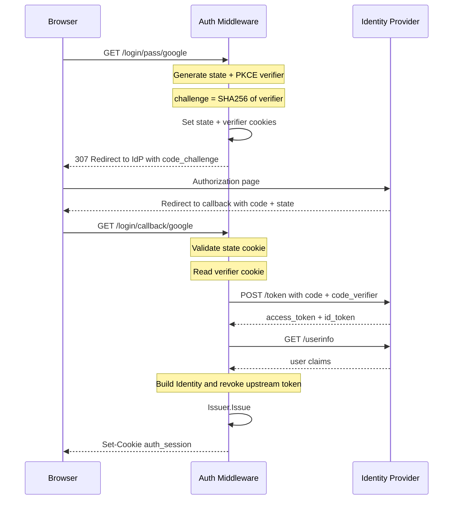
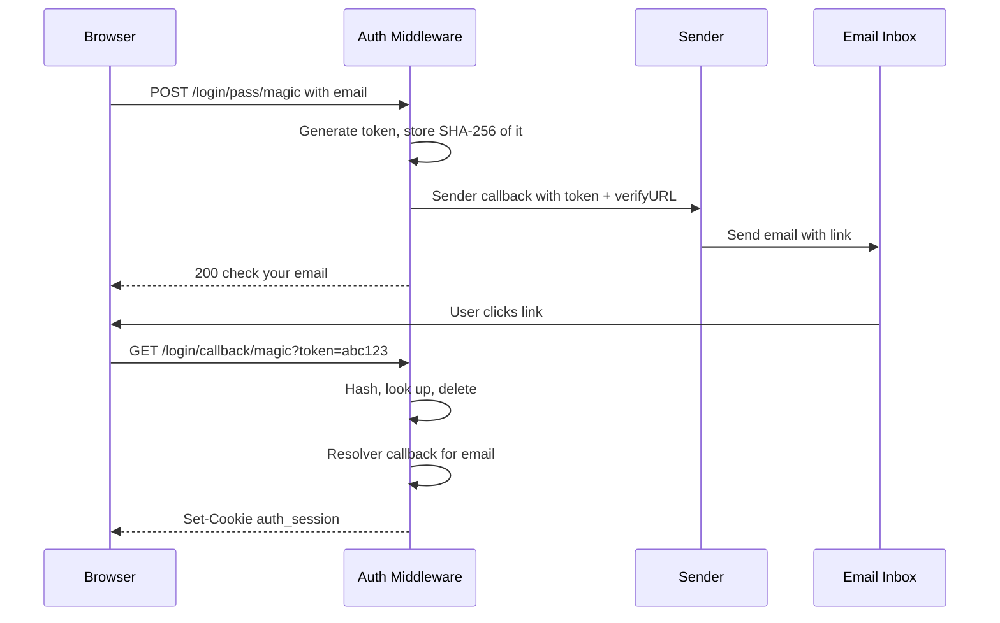

# Strategies

## Local Strategy

The local strategy authenticates using a user-supplied `Verifier` function. You own the credential check — it can be a database lookup, LDAP bind, bcrypt comparison, or anything else.

```go
import "github.com/rakunlabs/ada/middleware/auth/strategy/local"

authMW.Strategy(local.New("local",
    myVerifierFunc,
    local.WithLabel("Email & password"),
    local.WithPriority(0),
    local.WithFields(
        strategy.Field{Name: "email", Label: "Email", Type: "email", Required: true},
        strategy.Field{Name: "password", Label: "Password", Type: "password", Required: true},
    ),
))
```

The `Verifier` signature:

```go
type Verifier func(ctx context.Context, username, password string) (*identity.Identity, error)
```

Return `local.ErrInvalidCredentials` for bad credentials (produces 401). Any other error produces 500.

Add a limiter, and use `password` for the hash — the two things a credential
strategy needs that nothing else supplies:

```go
g := guard.New(guard.Config{}) // 5 failures, escalating lockout
defer g.Close()

authMW.Strategy(local.New("local", myVerifierFunc, local.WithLimiter(g)))
```

Only `ErrInvalidCredentials` counts against the account. An unexpected error is
a server fault, and counting it would let a database outage lock out every
user.

### Self-Service Sign-up

The local strategy can also create accounts. Pass a `Registrar` with `local.WithRegistrar(...)` — its presence enables signup for that strategy and the login UI grows a "Sign up" toggle.

```go
authMW.Strategy(local.New("local",
    LocalVerifier,
    local.WithLabel("Username & password"),
    local.WithRegistrar(func(ctx context.Context, req local.RegisterRequest) (*identity.Identity, error) {
        if len(req.Password) < 6 {
            return nil, fmt.Errorf("password must be at least 6 characters: %w", local.ErrInvalidInput)
        }

        user, err := db.CreateUser(ctx, req.Username, req.Password)
        if errors.Is(err, db.ErrDuplicate) {
            return nil, local.ErrUserExists
        }
        if err != nil {
            return nil, err
        }

        return &identity.Identity{
            Subject: user.ID,
            Name:    user.Name,
            Roles:   []string{"user"},
        }, nil
    }),
    local.WithAutoLogin(true),  // optional: issue a session immediately on success
))
```

The `Registrar` signature:

```go
type Registrar func(ctx context.Context, req local.RegisterRequest) (*identity.Identity, error)

type RegisterRequest struct {
    Username string
    Password string
    Extras   map[string]string  // any non-username/password fields from the form
}
```

Error contract:

| Return | HTTP | Use when |
|---|---|---|
| `nil` error | 200 | Account created |
| `local.ErrUserExists` | 409 | Username already taken |
| `local.ErrInvalidInput` (wrap with `fmt.Errorf("... : %w", local.ErrInvalidInput)`) | 400 | Validation failed; wrapped message is shown to the user |
| any other error | 500 | Unexpected failure |

**Customizing the sign-up form** — by default the form is `username`, `password`, `password_confirm` (all with matching labels). Override with `local.WithRegisterFields(...)`:

```go
local.WithRegisterFields(
    strategy.Field{Name: "username", Label: "Email",        Type: "email",    Required: true},
    strategy.Field{Name: "name",     Label: "Display name", Type: "text"},
    strategy.Field{Name: "password", Label: "Password",     Type: "password", Required: true},
    strategy.Field{Name: "password_confirm", Label: "Confirm password", Type: "password", Required: true},
)
```

- Fields matching the strategy's username/password keys are forwarded to the `Registrar` as `req.Username` / `req.Password`.
- `password_confirm` is matched client-side against `password` and stripped before the server sees it.
- Any other field (e.g. `name`, `email`) lands in `req.Extras["field_name"]`.

**Auto-login vs return to login** — `local.WithAutoLogin(true)` issues a session and redirects after a successful signup. Default (`false`) flips the UI back to the login form with an "Account created. Please sign in." notice.

**First-run bootstrap** — for self-hosted apps that want to show the signup form on first visit (until a user exists), set `auth.UIConfig.SignupFirst = true`. The UI lands on the signup form directly; flip it back to `false` once bootstrapped (or derive it from whether your user store is empty).

## OAuth2 / OIDC Strategy

The OAuth2 strategy supports the authorization code flow — with PKCE, `state`,
`nonce` and full `id_token` verification — and an optional password flow.

```go
import authoauth2 "github.com/rakunlabs/ada/middleware/auth/strategy/oauth2"

authMW.Strategy(authoauth2.New("google", authoauth2.Config{
    IssuerURL:    "https://accounts.google.com",  // OIDC Discovery
    ClientID:     os.Getenv("GOOGLE_CLIENT_ID"),
    ClientSecret: os.Getenv("GOOGLE_CLIENT_SECRET"),
    Scopes:       []string{"openid", "email", "profile"},
}, authoauth2.Options{
    Label:            "Sign in with Google",
    CallbackBasePath: "/login/callback",
}))
```

Set `CallbackBaseURL` to the fixed public origin when possible. If a reverse
proxy must supply `X-Forwarded-Proto` and `X-Forwarded-Host`, list only the
networks that connect directly to Ada:

```go
authMW.Strategy(authoauth2.New("google", cfg, authoauth2.Options{
    CallbackBasePath: "/login/callback",
    TrustedProxies:   []string{"10.0.0.0/8", "fd00::/8"},
}))
```

Without `TrustedProxies`, forwarded origin headers are ignored and the direct
request host/TLS are used. `UnsafeTrustAllForwardedHeaders` restores the legacy
trust-all behavior and should only be used behind a separately enforced network
boundary.

### OIDC Discovery

When `IssuerURL` is set, the strategy fetches `/.well-known/openid-configuration` to auto-populate:

| Discovered Field | Config Override |
|---|---|
| `authorization_endpoint` | `AuthURL` |
| `token_endpoint` | `TokenURL` |
| `userinfo_endpoint` | `UserInfoURL` |
| `revocation_endpoint` | `RevocationURL` |
| `end_session_endpoint` | `LogoutURL` |
| `jwks_uri` | `JWKSURL` |
| `issuer` | expected `iss` claim |

Explicitly set fields always take precedence over discovered ones.

Discovery happens once at construction. `New` logs a failure and returns a
strategy that still works with explicitly configured endpoints; use
`NewWithContext` to get the error and control the timeout.

Discovery documents and OAuth2 token, UserInfo, and JWKS responses are each
limited to 1 MiB. A response that exceeds the limit is rejected as an upstream
provider failure, not reported as a client `413`.

### PKCE (Proof Key for Code Exchange)

PKCE is **enabled by default** for the authorization code flow (RFC 7636). The strategy generates a `code_verifier` + `code_challenge` pair per authorization request and includes them in the flow automatically.

Set `DisablePKCE: true` only if your IdP does not support it.



### Manual Configuration (without Discovery)

```go
authoauth2.New("keycloak", authoauth2.Config{
    ClientID:      "my-app",
    ClientSecret:  "secret",
    AuthURL:       "https://kc.example.com/realms/main/protocol/openid-connect/auth",
    TokenURL:      "https://kc.example.com/realms/main/protocol/openid-connect/token",
    UserInfoURL:   "https://kc.example.com/realms/main/protocol/openid-connect/userinfo",
    RevocationURL: "https://kc.example.com/realms/main/protocol/openid-connect/revoke",
    LogoutURL:     "https://kc.example.com/realms/main/protocol/openid-connect/logout",
    Scopes:        []string{"openid", "email", "profile"},
}, authoauth2.Options{
    Label:            "Sign in with Keycloak",
    CallbackBasePath: "/login/callback",
})
```

## API Key Strategy

Header-based authentication for service-to-service or CLI access. No login UI — validates tokens from request headers.

```go
import "github.com/rakunlabs/ada/middleware/auth/strategy/apikey"

authMW.Strategy(apikey.New("apikey",
    func(ctx context.Context, key string) (*identity.Identity, error) {
        // Look up the key in your database
        user, err := db.FindByAPIKey(ctx, key)
        if err != nil {
            return nil, apikey.ErrInvalidKey
        }
        return &identity.Identity{
            Subject: user.ID,
            Email:   user.Email,
            Roles:   user.Roles,
        }, nil
    },
))
```

By default reads `Authorization: Bearer <token>` and falls back to `X-API-Key: <token>`. Customize with options:

```go
apikey.New("apikey", validator,
    apikey.WithHeaderName("X-Custom-Key"),  // read from a specific header
    apikey.WithBearerPrefix(false),         // don't strip "Bearer " prefix
)
```

::: info
API Key strategy is hidden from the login UI by default. It's designed for programmatic access alongside browser-based strategies.
:::

## Bearer Token Strategy

Validates an OAuth 2.0 access token minted by an external authorization server (Keycloak, turna, Auth0, Entra) instead of issuing one. This is what turns an ada service into an OAuth **resource server** — see [Resource Server](./resource-server) for the full picture.

```go
import "github.com/rakunlabs/ada/middleware/auth/strategy/bearer"

bearerStrategy, err := bearer.New(bearer.Config{
    Issuer:   "https://kc.example.com/realms/main",
    Audience: []string{"https://api.example.com/mcp"},
})
if err != nil {
    return err
}

authMW.Strategy(bearerStrategy)
```

The token is verified against the issuer's JWKS — discovered from `Issuer` unless `JWKSURL` is set — then checked for `iss`, `aud`, `exp` and `nbf`. Claims become an `Identity`; `scope`/`scp` become `Identity.Scopes`, and `roles` plus `realm_access.roles` become `Identity.Roles`.

::: warning
`Audience` is required. It is the only thing stopping a token another service on the same authorization server legitimately received from being replayed here. `DisableAudienceCheck` exists for the rare deployment that is the sole audience its issuer ever mints for — everyone else who sets it has turned a single-service compromise into a fleet-wide one.
:::

## LDAP Strategy

Username/password authentication against an LDAP directory (Active Directory, OpenLDAP). Uses the same login form as the local strategy.

```go
import "github.com/rakunlabs/ada/middleware/auth/strategy/ldap"

authMW.Strategy(ldap.New("ldap", ldap.Config{
    Address:      "ldap://ad.example.com:389",
    BaseDN:       "dc=example,dc=com",
    BindDN:       "cn=service,dc=example,dc=com",
    BindPassword: os.Getenv("LDAP_BIND_PASSWORD"),
    UserFilter:   "(sAMAccountName=%s)",  // default: "(uid=%s)"
    AttributeMap: ldap.AttributeMap{
        Subject: "sAMAccountName",
        Email:   "mail",
        Name:    "displayName",
        Roles:   "memberOf",
    },
}, myLDAPConnector,  // you provide the LDAP connection implementation
    ldap.WithLabel("Corporate Login"),
))
```

The strategy uses a `Connector` interface so it has zero external dependencies — you inject your LDAP library:

```go
type Connector interface {
    Connect(ctx context.Context) (Conn, error)
}

type Conn interface {
    Bind(dn, password string) error
    Search(baseDN, filter string, attributes []string) ([]Entry, error)
    Close() error
}
```

This means you can use `go-ldap`, `go-ldap/v3`, or any other LDAP library by wrapping it in this interface.

## Magic Link Strategy

Passwordless email-based authentication. User enters their email, receives a one-time link, and clicks it to log in.

```go
import (
    "github.com/rakunlabs/ada/middleware/auth/guard"
    "github.com/rakunlabs/ada/middleware/auth/strategy/magiclink"
)

send := func(ctx context.Context, email, token, verifyURL string) error {
    // Deliver the magic link via your email service.
    return emailService.Send(ctx, email, "Login link", verifyURL)
}

resolve := func(ctx context.Context, email string) (*identity.Identity, error) {
    user, err := db.FindOrCreateByEmail(ctx, email)
    if err != nil {
        return nil, err
    }

    return &identity.Identity{Subject: user.ID, Email: email, Name: user.Name}, nil
}

authMW.Strategy(magiclink.New("magic", send, resolve,
    magiclink.WithLabel("Sign in with email"),
    magiclink.WithTokenTTL(15*time.Minute),
    // Prefer a fixed public origin. Without this or a trusted-proxy policy,
    // link generation fails closed before the Sender is called.
    magiclink.WithVerifyBaseURL("https://app.example.com"),
    // Without a limiter the send endpoint is an open relay pointed at
    // anybody's inbox, and a free user-enumeration oracle.
    magiclink.WithLimiter(g),
))
```

The link points at `{base}login/callback/{name}`, wired automatically at
`Mount`. `WithVerifyBaseURL` supplies its scheme and host. If the public origin
must come from the request instead, trust only the immediate proxy networks:

```go
magiclink.WithTrustedProxies("10.0.0.0/8", "fd00::/8")
```

Only requests from those peers may use `X-Forwarded-Proto` or
`X-Forwarded-Host` to build a link. The proxy must overwrite incoming host and
forwarding headers. Without `WithVerifyBaseURL` or a matching trusted-proxy
policy, the send endpoint returns `verify_origin_unavailable` and does not call
the sender. `WithUnsafeRequestOrigin()` restores the old trust-all behavior,
but allows an untrusted caller to choose where another user's login link points.

Override the callback path with `WithVerifyPath` only if you mount the route
yourself; it does not configure or validate the public origin.

Flow:



The strategy ships with a built-in in-memory `TokenStore` (single-process, with
a background sweeper). For production, provide your own Redis/DB-backed store:

```go
type TokenStore interface {
    Store(ctx context.Context, token, email string, ttl time.Duration) error
    Consume(ctx context.Context, token string) (email string, err error)
    Delete(ctx context.Context, token string) error
}
```

The `token` a store sees is the SHA-256 of the value that went out by email,
never the value itself — the same reason a password is not stored in the clear.

## HTTP Basic Strategy

Standard HTTP Basic authentication (RFC 7617). The browser shows its native credential dialog — no login page needed.

```go
import "github.com/rakunlabs/ada/middleware/auth/strategy/basic"

authMW.Strategy(basic.New("basic",
    func(ctx context.Context, user, pass string) (*identity.Identity, error) {
        // Same Verifier signature as the local strategy
        if user == "admin" && pass == "secret" {
            return &identity.Identity{Subject: "admin"}, nil
        }
        return nil, basic.ErrInvalidCredentials
    },
    basic.WithRealm("My Application"),
))
```

When no `Authorization` header is present, the strategy responds with `401` + `WWW-Authenticate: Basic realm="My Application"` which triggers the browser's native login popup.

::: info
HTTP Basic is hidden from the login UI by default. It's useful for API endpoints, dev tools, or as a fallback when the browser-based UI isn't needed.
:::

## Header/Proxy Strategy

Trusts identity from headers set by an upstream reverse proxy (Traefik, nginx, Envoy). Zero user interaction — the proxy handles authentication.

```go
import "github.com/rakunlabs/ada/middleware/auth/strategy/header"

authMW.Strategy(header.New("proxy",
    // Required trust boundary: only the ingress network may assert identity.
    header.WithTrustedProxies("10.0.0.0/8", "fd00::/8"),
    header.WithHeaderMap(header.HeaderMap{
        User:   "X-Forwarded-User",   // → Identity.Subject
        Email:  "X-Forwarded-Email",  // → Identity.Email
        Name:   "X-Forwarded-Name",   // → Identity.Name
        Roles:  "X-Forwarded-Roles",  // comma-separated → Identity.Roles
        Groups: "X-Forwarded-Groups", // comma-separated → Identity.Claims["groups"]
    }),
))
```

All header names have sensible defaults (`X-Forwarded-User`, `X-Forwarded-Email`, etc.).

These headers carry no proof of anything, so the strategy requires an explicit
trust boundary:

```go
// Only the proxy's network may claim an identity.
authMW.Strategy(header.New("proxy", header.WithTrustedProxies("10.0.0.0/8")))

// Or, where the network cannot be separated, a shared secret.
authMW.Strategy(header.New("proxy",
    header.WithSharedSecret("X-Proxy-Secret", os.Getenv("PROXY_SECRET")),
))

// Both options may be combined; then both checks must pass.
authMW.Strategy(header.New("proxy",
    header.WithTrustedProxies("10.0.0.0/8"),
    header.WithSharedSecret("X-Proxy-Secret", os.Getenv("PROXY_SECRET")),
))
```

The check is against `RemoteAddr`, never `X-Forwarded-For` — an attacker sets
that as easily as the header it is meant to guard. With neither option the
strategy fails closed with the same `401` used for a missing identity header.
Deployments whose network boundary is enforced entirely outside the process can
opt into the legacy behavior with `header.WithUnsafeTrustAll()`, but
`WithTrustedProxies`, `WithSharedSecret`, or both are preferred.

The strategy deliberately does **not** implement `RequestAuthenticator`: header
identity is accepted at the login endpoint only, so a misrouted deployment
exposes one route instead of every route.

## mTLS Strategy

Authenticates callers by their TLS client certificate, natively or behind a
terminating proxy.

```go
import "github.com/rakunlabs/ada/middleware/auth/strategy/mtls"

// Native: TLS terminates in this process. Requires tls.Config.ClientCAs and
// ClientAuth set to RequireAndVerifyClientCert (or VerifyClientCertIfGiven).
s, err := mtls.New("mtls", func(ctx context.Context, cert *x509.Certificate) (*identity.Identity, error) {
    svc, ok := registry.Lookup(mtls.Fingerprint(cert))
    if !ok {
        return nil, strategy.ErrInvalidCredentials
    }

    return &identity.Identity{Subject: svc.ID, Roles: svc.Roles}, nil
})

// Proxy: the certificate arrives in a header.
s, err := mtls.New("mtls", verify, mtls.WithProxy(mtls.ProxyConfig{
    TrustedCIDRs: []string{"10.0.0.0/8"},
    CertHeader:   "X-Forwarded-Tls-Client-Cert",
    VerifyHeader: "X-Forwarded-Tls-Client-Cert-Info",
}))
```

Only `tls.ConnectionState.VerifiedChains` is consulted, never
`PeerCertificates` — the latter holds whatever the client sent, validated or
not. With no verifier, the identity is derived from the certificate itself:
`Subject` is the SHA-256 fingerprint (a CN is neither unique nor
authoritative), `Roles` come from the subject's OU values.

It implements `RequestAuthenticator`, so a client presenting a certificate is
authenticated on protected routes directly, without a session.

## Passkey Strategy

WebAuthn / FIDO2 passwordless login using device biometrics (Touch ID, Windows Hello) or a roaming security key. The implementation is **stdlib-only** — CBOR/COSE/attestation parsing is hand-rolled, no third-party dependency.

```go
import "github.com/rakunlabs/ada/middleware/auth/strategy/passkey"

engine, err := passkey.New(&passkey.Config{
    RPID:             "example.com",                        // bare host, no scheme
    RPDisplayName:    "Example",                            // shown in the platform UI
    RPOrigins:        []string{"https://example.com"},      // exact origins to accept
    UserVerification: passkey.UVPreferred,                  // ask for biometric/PIN when possible
    ChallengeTTL:     5 * time.Minute,
})
if err != nil { return err }

strategy, err := passkey.NewStrategy("passkey", engine,
    func(ctx context.Context, credentialID []byte) (*passkey.Credential, *identity.Identity, error) {
        // Look up the credential in your store. Return passkey.ErrCredentialNotFound
        // for any unresolved input (unknown id, disabled user, etc.) so the strategy
        // emits a uniform 401 — never leak which credential ids you've seen.
        row, err := db.PasskeyByCredentialID(ctx, credentialID)
        if err != nil {
            return nil, nil, passkey.ErrCredentialNotFound
        }
        return &passkey.Credential{
                ID:         row.CredentialID,
                UserHandle: row.UserHandle,
                PublicKey:  row.PublicKey,        // raw COSE_Key bytes
                AAGUID:     row.AAGUID,
                SignCount:  row.SignCount,
                Transports: row.Transports,
            },
            &identity.Identity{Subject: row.Username, Provider: "passkey"},
            nil
    },
    passkey.WithLabel("Sign in with a passkey"),
    passkey.WithSignCountUpdater(func(ctx context.Context, credentialID []byte, newCount uint32) error {
        return db.UpdatePasskeySignCount(ctx, credentialID, newCount)
    }),
)
if err != nil { return err }

authMW.Strategy(strategy)
```

### Registration endpoints

ada **does not** mount registration endpoints — the RP owns persistence and policy, and a registration ceremony is almost always gated on an already-authenticated session. You mount them yourself:

```go
mux.POST("/passkey/register/begin", mux.Wrap(func(c *ada.Context) error {
    user := identity.FromContext(c.Request.Context()) // current signed-in user
    opts, session, err := engine.BeginRegistration(passkey.User{
        Handle:      []byte(user.Subject),            // ≤64 bytes, stable per user
        Name:        user.Subject,
        DisplayName: user.Name,
    }, db.ExcludeCredentialsFor(user.Subject))
    if err != nil { return err }
    sid := db.SaveRegSession(user.ID, session)       // short-TTL store, your storage
    return c.SetStatus(200).SendJSON(map[string]any{"session_id": sid, "options": opts})
}))

mux.POST("/passkey/register/finish", mux.Wrap(func(c *ada.Context) error {
    var req struct {
        SessionID string          `json:"session_id"`
        Response  json.RawMessage `json:"response"`
    }
    if err := c.Bind(&req); err != nil { return err }
    session, ok := db.TakeRegSession(req.SessionID)
    if !ok { return c.SetStatus(401).SendJSON(map[string]string{"error": "invalid_session"}) }
    cred, _, err := engine.FinishRegistration(session, req.Response)
    if err != nil { return err }
    return db.SaveCredential(user.Subject, cred)      // persist for future logins
}))
```

The login endpoint is mounted automatically at `POST /login/pass/{name}` — the SPA dispatches between begin/finish by including or omitting the `assertion` field in the JSON body.

### Username-first vs discoverable flow

By default the ceremony is **discoverable** — the SPA posts an empty body and the authenticator picks any resident credential. Add `WithUserCredentialsLookup` for the **username-first** flow:

```go
strategy, _ := passkey.NewStrategy("passkey", engine, lookup,
    passkey.WithUserCredentialsLookup(func(ctx context.Context, hint passkey.UserHint) ([][]byte, error) {
        // hint.Username is the typed identifier; hint.Handle is the cached user handle.
        // Returning a non-empty slice scopes allowCredentials; returning (nil, nil) for
        // unresolvable hints lets the ceremony fall back to discoverable without leaking
        // which usernames exist.
        if hint.Username == "" { return nil, nil }
        return db.CredentialIDsByUsername(ctx, hint.Username)
    }),
)
```

The SPA then posts `{ "username": "alice" }` to the begin step instead of an empty body.

### Conditional UI (autofill)

Browsers that support [Conditional Mediation](https://w3c.github.io/webauthn/#sctn-conditional-ui) (Safari 16+, Chrome 108+) surface enrolled passkeys inline with the username field's autocomplete dropdown — no button click required. The built-in ada login UI activates this automatically when a passkey strategy is advertised; custom SPAs opt in with `autocomplete="username webauthn"` on the username input plus `mediation: "conditional"` on `navigator.credentials.get`.

### Algorithms

`passkey.DefaultAlgorithms` advertises ES256 → EdDSA → RS256 in that order. The verification path additionally accepts ES384/ES512 and PS256/PS384/PS512. EdDSA (Ed25519, COSE alg -8) is supported as of v0.5.

Attestation formats: **`"none"`** (the default — what platform authenticators emit) and **`"packed"`** with self or x5c-basic. Other formats (`tpm`, `android-key`, `android-safetynet`, `apple`, `fido-u2f`) are deliberately unsupported.

### Clustered deployments

The default `ChallengeStore` is in-memory and won't survive a load-balancer that routes begin/finish to different instances. Inject your own backend with `WithChallengeStore` — any type that satisfies the three-method `ChallengeStore` interface works (Redis is a typical choice).

### Sign-count replay defense

`WithSignCountUpdater` persists the new sign counter after every successful login. Hardware keys advance the counter on each use; if a stored value is non-zero and the next assertion presents a smaller value, the strategy rejects the login (cloned-authenticator defense). Platform authenticators always report 0 — that's not a regression and is accepted.

## Multiple Strategies

Register multiple strategies — the login UI renders all of them automatically:

```go
authMW.Strategy(local.New("local", myVerifier, local.WithLabel("Email & password")))
authMW.Strategy(authoauth2.New("google", googleCfg, authoauth2.Options{Label: "Google"}))
authMW.Strategy(authoauth2.New("github", githubCfg, authoauth2.Options{Label: "GitHub"}))
authMW.Strategy(magiclink.New("magic", send, resolve,
    magiclink.WithLabel("Email link"),
    magiclink.WithVerifyBaseURL("https://app.example.com"),
    magiclink.WithLimiter(g),
))
authMW.Strategy(apikey.New("apikey", keyValidator))    // hidden from UI
authMW.Strategy(basic.New("basic", verifier))           // hidden, browser dialog
authMW.Strategy(header.New("proxy",
    header.WithTrustedProxies("10.0.0.0/8"),
))                                                       // hidden, proxy-injected
```

The UI groups them: form-based strategies (local, LDAP, magic link, password-flow OAuth2) show as tab-switchable forms; redirect-based strategies (OAuth2 code flow) show as buttons below an "or" divider. API key, basic, and header strategies are hidden from the UI.
